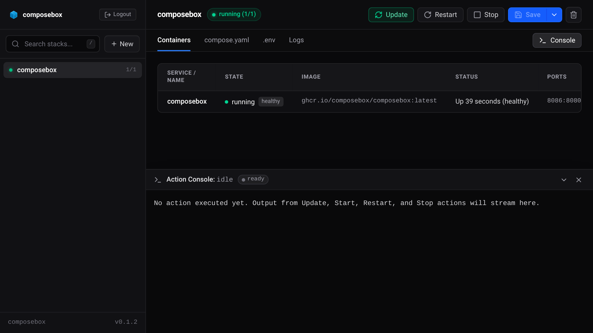

# composebox

A lightweight web UI and manager for Docker Compose stacks, distributed as a single static binary.

[](https://github.com/composebox/composebox/releases)
[](https://golang.org)
[](https://github.com/composebox/composebox/pkgs/container/composebox)
[](https://github.com/composebox/composebox/pkgs/container/composebox)
[](LICENSE)

`composebox` points to a directory of Docker Compose projects on your filesystem, discovers each stack automatically, and provides a responsive dark-mode web interface to edit compose definitions and environment variables, control container lifecycles, and stream real-time logs.

<p align="center">
  
</p>

---

## Highlights

- **Filesystem-as-Database:** 1 directory = 1 stack. Uses standard `compose.yaml` and `.env` files without proprietary database layers or synchronization drift.
- **Embedded Single Binary:** Built in Go with Svelte 5 and Tailwind CSS v4 assets bundled via Go's native `embed` package (`//go:embed`). No Node.js runtime required in production.
- **Minimal Footprint:** Idles around ~15MB of RAM with sub-second container startup times.
- **Integrated Security:** First-run browser password setup, bcrypt password hashing, and constant-time HMAC-SHA256 session signatures. Password manager and Bitwarden autofill compatible.
- **Resilient Log Streaming:** Server-Sent Events (SSE) stream `docker compose logs -f` without WebSocket proxy drops.
- **Safe File Writes & Dual Workflow:** Modifications to `compose.yaml` and `.env` are staged into a temporary file and swapped atomically (`atomicWriteFile`). Supports dual-action workflows: save draft to disk only (`Ctrl+S`), or save and immediately deploy in one step via `docker compose up` (`Ctrl+Enter`).
- **Keyboard Shortcuts:** Built-in shortcut handlers for common workflow operations (`Ctrl+S`, `Ctrl+Enter`, `/`, `Esc`).

---

## Quick Start

### 1. Docker Compose (Standard)

```yaml
services:
  composebox:
    image: ghcr.io/composebox/composebox:latest
    container_name: composebox
    restart: unless-stopped
    ports:
      - "127.0.0.1:8080:8080"
    volumes:
      - /var/run/docker.sock:/var/run/docker.sock
      - /path/to/your/stacks:/stacks
    environment:
      - STACKS_DIR=/stacks
      - PORT=8080
```

### 2. Hardened Setup with `docker-socket-proxy` (Recommended for Zero Raw Socket Exposure)

If you prefer not to mount `/var/run/docker.sock` directly into the web application, run Composebox alongside [`docker-socket-proxy`](https://github.com/Tecnativa/docker-socket-proxy). Composebox connects over an internal Docker network via `DOCKER_HOST`, and sensitive Docker subsystems (Swarm, Secrets, Engine Plugins, System Reclaims) are completely blocked:

```yaml
services:
  composebox:
    image: ghcr.io/composebox/composebox:latest
    container_name: composebox
    restart: unless-stopped
    ports:
      - "127.0.0.1:8080:8080"
    volumes:
      - /path/to/your/stacks:/stacks
    environment:
      - STACKS_DIR=/stacks
      - PORT=8080
      - DOCKER_HOST=tcp://socket-proxy:2375
    depends_on:
      - socket-proxy
    networks:
      - default
      - socket-net

  socket-proxy:
    image: tecnativa/docker-socket-proxy:latest
    container_name: composebox-socket-proxy
    restart: unless-stopped
    volumes:
      - /var/run/docker.sock:/var/run/docker.sock:ro
    environment:
      - CONTAINERS=1
      - IMAGES=1
      - NETWORKS=1
      - VOLUMES=1
      - POST=1
      - INFO=1
      - VERSION=1
      - EVENTS=1
      - AUTH=0
      - SECRETS=0
      - SWARM=0
      - PLUGINS=0
      - SYSTEM=0
    networks:
      - socket-net

networks:
  socket-net:
    internal: true
```
*(Also available directly as [`docker-compose.hardened.yml`](docker-compose.hardened.yml).)*

### 3. Rootless Docker

If you run Rootless Docker, map your user-namespaced Docker socket instead of the system root socket:

```yaml
services:
  composebox:
    image: ghcr.io/composebox/composebox:latest
    container_name: composebox
    restart: unless-stopped
    ports:
      - "127.0.0.1:8080:8080"
    volumes:
      - /run/user/1000/docker.sock:/var/run/docker.sock
      - /path/to/your/stacks:/stacks
    environment:
      - STACKS_DIR=/stacks
      - PORT=8080
```

### 4. Standalone Binary (Bare-Metal / systemd)

Download the release binary for your architecture (`linux/amd64` or `linux/arm64`) from [Releases](https://github.com/composebox/composebox/releases) and run directly on your host without container virtualization:

```bash
./composebox -stacks /path/to/your/stacks -port 8080
```

To run as a systemd service (e.g. `/etc/systemd/system/composebox.service`):

```ini
[Unit]
Description=Composebox Docker Compose Manager
After=network.target docker.service
Requires=docker.service

[Service]
Type=simple
User=ubuntu
Group=docker
ExecStart=/usr/local/bin/composebox -stacks /home/ubuntu/services -port 8080
Restart=always
RestartSec=3

[Install]
WantedBy=multi-user.target
```

---

## Configuration & Customization

Settings can be specified using command-line arguments or environment variables. Command-line flags take precedence over environment variables.

| Flag | Environment Variable | Default | Description |
|---|---|---|---|
| `-port` | `PORT` | `8080` | Port to listen on |
| `-host` | `HOST` | `127.0.0.1` | IP interface to bind to (`0.0.0.0` in container image) |
| `-stacks` | `STACKS_DIR` | `./stacks` | Directory where Docker Compose stacks are stored |
| `-password` | `COMPOSEBOX_PASSWORD` | *(empty)* | Predefined admin password (skips web setup) |
| `-no-auth` | `NO_AUTH` | `false` | Disable authentication entirely |
| `-trusted-proxies` | `TRUSTED_PROXIES` | `127.0.0.1,::1` | Comma-separated list of trusted proxy IPs/CIDRs allowed to set client IP headers |
| `-version` | — | — | Print version information and exit |

---

## Reverse Proxy & Ingress Setup

`composebox` binds to `0.0.0.0` or `127.0.0.1` and works seamlessly behind reverse proxies and tunneling agents. Because real-time logs are streamed via Server-Sent Events (SSE), ensure proxy buffering is disabled.

### Cloudflare Tunnel (`cloudflared`)

Add an ingress rule to your `/etc/cloudflared/config.yml`:

```yaml
ingress:
  - hostname: compose.example.com
    service: http://127.0.0.1:8080
  - service: http_status:404
```

### Nginx

```nginx
server {
    server_name compose.example.com;

    location / {
        proxy_pass http://127.0.0.1:8080;
        proxy_http_version 1.1;
        proxy_set_header Host $host;
        proxy_set_header X-Real-IP $remote_addr;
        proxy_set_header X-Forwarded-For $proxy_add_x_forwarded_for;
        proxy_set_header X-Forwarded-Proto $scheme;

        # Disable proxy buffering for real-time SSE log streaming
        proxy_buffering off;
        proxy_cache off;
        proxy_read_timeout 24h;
    }
}
```

### Caddy

```caddy
compose.example.com {
    reverse_proxy 127.0.0.1:8080
}
```

---

## Keyboard Shortcuts

The web interface includes built-in keyboard navigation:

| Keybinding | Action |
|---|---|
| `Ctrl + S` / `Cmd + S` | Save active `compose.yaml` and `.env` files to disk (Save Draft) |
| `Ctrl + Enter` / `Cmd + Enter` | Atomically save files to disk and immediately deploy (`docker compose up`) |
| `/` | Focus stack search filter in the sidebar |
| `Esc` | Close open modals or clear active filters |

---

## Security Architecture & Best Practices

Composebox is engineered with defense-in-depth principles across the application, network, and host boundaries:

### 1. Docker Daemon Isolation (Zero Raw Socket Exposure)
- **Native `DOCKER_HOST` Support:** Composebox communicates with Docker via the standard Docker CLI, respecting the `DOCKER_HOST` environment variable.
- **Socket Proxy Compatible:** Rather than mounting `/var/run/docker.sock` directly into the container, users can deploy the official [hardened recipe](docker-compose.hardened.yml) using [`docker-socket-proxy`](https://github.com/Tecnativa/docker-socket-proxy) to limit the Docker API strictly to container lifecycle verbs while blocking daemon-level administrative APIs (Swarm, Secrets, Engine plugins, system reclaims).
- **Rootless Docker Ready:** Runs out-of-the-box with Rootless Docker (`/run/user/1000/docker.sock`), ensuring that even if a container could escape, it lands as an unprivileged user on the host OS.

### 2. Container & Process Isolation
- **Non-Root Execution:** The production container runs with non-root user and group (`USER 1001:1001`) with Docker group membership (`GID 988`), preventing any container-internal privilege escalation.
- **Least Privilege Bind Mounts:** Stacks directory mounts require only standard user ownership, and auth credentials are written with strict `0600` permissions.

### 3. CSRF & Same-Origin Defense
- **Origin & Referer Enforcement:** All state-changing REST endpoints (`POST`, `DELETE`) enforce strict Origin and Referer validation against the server host to prevent cross-site request forgery.
- **Custom Header Verification:** Protected mutation calls require the `X-Composebox-Client` header, which modern browsers prevent cross-origin scripts from forging under standard CORS policies.
- **Secure Cookie Flags:** Session cookies are set with `HttpOnly`, `SameSite=Strict`, and `Path=/`.

### 4. Authentication & Session Security
- **Setup Wizard:** Fresh installations without `COMPOSEBOX_PASSWORD` launch an interactive first-run wizard. The admin password is encrypted with bcrypt and stored at `.composebox.auth` with `0600` permissions.
- **Persistent HMAC Sessions:** Session tokens are cryptographically signed with HMAC-SHA256 using a persistent secret stored at `.composebox.secret`. Sessions survive server restarts without re-login.
- **Per-IP Brute-Force Rate Limiting:** Login attempts are rate-limited per client IP with a 5-failure threshold and a 30-second lockout window to prevent brute-force attacks. Forwarding headers (`CF-Connecting-IP`, `X-Forwarded-For`) are only evaluated when the caller originates from configured `TRUSTED_PROXIES`.
- **Headless & GitOps:** Pass `COMPOSEBOX_PASSWORD=your-secret-password` or `NO_AUTH=true` for automated or air-gapped deployments behind upstream authentication (e.g. Cloudflare Access, Authelia).

### 5. Data Integrity & Safe Stack Operations
- **Atomic File Writes with Physical Fsync:** Changes to `compose.yaml` and `.env` are staged into temporary files, synced to disk via `fsync` on both data and parent directory entries, and swapped atomically to eliminate corrupted or partially written configurations.
- **Decoupled Process Execution:** Lifecycle operations (`up`, `down`, `restart`, `pull`, `update`) are decoupled from client HTTP request lifetimes (`context.WithoutCancel`), preventing broken or partial containers if a browser tab is closed or reloaded mid-operation. Extended 15-minute deadlines are granted to large registry pulls.
- **Safe Stack Deletion (.trash archive):** Deleting a stack in Composebox moves the directory to `.trash/<stack>_<timestamp>` instead of executing destructive `rm -rf`. Additionally, deletion is automatically blocked if the stack contains persistent database or volume subdirectories.

---

## REST API Reference

All protected endpoints require an authenticated session cookie (`composebox_session`) or Bearer token header.

| Method | Endpoint | Description |
|---|---|---|
| `GET` | `/api/health` | Health check endpoint returning status and version |
| `GET` | `/api/auth/status` | Returns whether authentication is enabled and current login state |
| `POST` | `/api/auth/setup` | Initializes admin password on fresh installations |
| `POST` | `/api/auth/login` | Authenticates admin credentials and returns session token |
| `POST` | `/api/auth/logout` | Invalidates active session cookie |
| `GET` | `/api/stacks` | Lists all discovered stacks, container statuses, and ports |
| `POST` | `/api/stacks` | Scaffolds a new stack folder with initial compose file |
| `GET` | `/api/stacks/{name}` | Returns stack details, service containers, and file contents |
| `POST` | `/api/stacks/{name}/save` | Atomically saves updated `compose.yaml` and `.env` contents |
| `DELETE` | `/api/stacks/{name}` | Safely removes stopped stack directory from disk |
| `POST` | `/api/stacks/{name}/up` | Executes `docker compose up -d --remove-orphans` |
| `POST` | `/api/stacks/{name}/down` | Executes `docker compose down` |
| `POST` | `/api/stacks/{name}/restart` | Executes `docker compose restart` |
| `POST` | `/api/stacks/{name}/pull` | Executes `docker compose pull` |
| `POST` | `/api/stacks/{name}/update` | Executes `docker compose pull` followed by `up -d --remove-orphans` |
| `GET` | `/api/stacks/{name}/logs` | Streams live Docker logs as Server-Sent Events (`text/event-stream`) |

---

## Building from Source

### Prerequisites

- **Go:** 1.26 or later
- **Node.js:** 22 or later (for compiling the Svelte UI)
- **Make:** Standard build utility (optional)

### Build Steps

```bash
# 1. Clone repository
git clone https://github.com/composebox/composebox.git
cd composebox

# 2. Build the Svelte UI and compile static binary
make build

# 3. Run unit and integration tests
make test

# 4. (Optional) Build multi-arch container image
make docker
```

The compiled standalone binary is placed at `bin/composebox`.

---

## Project Structure

```
composebox/
├── cmd/composebox/       # Application entrypoint & CLI flag handling
├── internal/
│   ├── auth/             # Bcrypt hashing, persistent secrets, constant-time HMAC sessions
│   ├── config/           # Environment and CLI configuration parser
│   ├── server/           # REST router, middleware, and SSE stream handlers
│   └── stack/            # Directory scanner, atomic file I/O, & Docker Compose runner
├── ui/                   # Svelte 5 runes + Tailwind CSS v4 + bits-ui frontend
│   ├── src/              # Svelte components, reactivity runes, and API client
│   ├── embed.go          # Go embed fs wrapper for compiled assets
│   ├── package.json      # Frontend build dependencies
│   └── vite.config.js    # Vite compilation config
├── Dockerfile            # Multi-stage reproducible container build
├── Makefile              # Development and release automation
└── README.md
```

---

## License

This project is licensed under the [MIT License](LICENSE).
